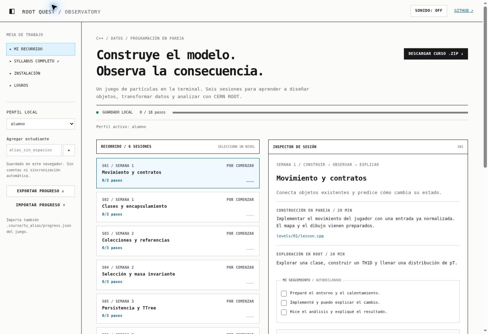

# ROOT Quest · C++ & CERN ROOT

Seis sesiones de programación en pareja. Un juego de criaturas de partículas en
una **TUI nativa de C++**, con niveles independientes, logros y análisis real en ROOT.
El motor entrega teclado, dibujo, encuentros y comprobaciones. Ustedes construyen
las decisiones y el modelo de cada sesión.

[Syllabus y seguimiento](https://fbientrigo.github.io/cpp_root_course/) ·
[Descargar ZIP](https://github.com/fbientrigo/cpp_root_course/archive/refs/heads/main.zip)



## Instalación

**Recomendado: Ubuntu o Windows con Ubuntu/WSL2.** Solo GCC/Clang y Python 3.8+
para el juego. GDB y VS Code para depurar. Sin pip/npm, CMake, bibliotecas de juego
ni conexión de red después de preparar las herramientas.

```bash
sudo apt update
sudo apt install g++ gdb python3 git
git clone https://github.com/fbientrigo/cpp_root_course.git
cd cpp_root_course
bash course.sh doctor
bash course.sh demo 1 --sound
```

También puedes descargar el ZIP, extraerlo y abrir la carpeta donde está `course.py`.
El comando `doctor` muestra las herramientas que encuentra; ROOT es opcional.
En WSL, abre esa carpeta con `code .` y usa la extensión WSL de VS Code.

### Instalar ROOT 6 en WSL2 (Ubuntu 24.04, x86_64)

ROOT **no es necesario para el juego**, pero sí para las macros de `analysis/`
y los programas C++ que incluyan bibliotecas ROOT. Comprueba primero tu sistema
con `source /etc/os-release; echo "$PRETTY_NAME"; uname -m`. Estos comandos
son para **Ubuntu 24.04 x86_64**; si usas otra versión, elige su binario en
[las distribuciones oficiales de ROOT](https://root.cern.ch/releases/release-64004/).

```bash
sudo apt update
sudo apt install -y g++ gdb clangd python3 git wget libtbb-dev \
  libx11-dev libxext-dev libxft-dev libxpm-dev libglu1-mesa-dev
mkdir -p "$HOME/opt/root-6.40.04"
wget -O /tmp/root-6.40.04.tar.gz \
  https://root.cern/download/root_v6.40.04.Linux-ubuntu24.04-x86_64-gcc13.3.tar.gz
tar -xzf /tmp/root-6.40.04.tar.gz -C "$HOME/opt/root-6.40.04" --strip-components=1
source "$HOME/opt/root-6.40.04/bin/thisroot.sh"
root-config --version
root -l -b -q
```

Esta instalación se mantiene fuera del repositorio y no requiere Conda.
Actívala en cada terminal WSL con `source "$HOME/opt/root-6.40.04/bin/thisroot.sh"`.
Si quieres activarla automáticamente, añade **una sola vez** esa línea a
`~/.bashrc` y abre una terminal nueva. No mezcles esta activación con otra
instalación de ROOT. En Ubuntu 22.04/26.04 usa el archivo oficial construido
para esa versión, nunca el de 24.04.

### Windows nativo / PowerShell

Instala [MSYS2](https://www.msys2.org/), abre **MSYS2 UCRT64** y ejecuta:

```bash
pacman -S --needed mingw-w64-ucrt-x86_64-gcc mingw-w64-ucrt-x86_64-gdb mingw-w64-ucrt-x86_64-python
```

Agrega `C:\msys64\ucrt64\bin` al PATH del usuario y reinicia VS Code/PowerShell.
Comprueba `g++ --version`, `gdb --version` y `python --version`.

```powershell
python course.py doctor
python course.py demo 1 --sound
python course.py play 1 --student mi_alias
```

`./course.ps1 play 1` es un atajo opcional. Si la política de PowerShell bloquea
scripts, usa directamente `python course.py`; no necesitas cambiar la política.
El compilador MSVC no está configurado en esta primera versión. Git Bash por sí
solo no instala un compilador. ROOT en Windows se trabaja preferentemente en WSL.

### VS Code: entorno recomendado por proyecto

El repositorio incluye `.vscode/extensions.json`, `.vscode/settings.json` y
`.clangd`. Abre **la raíz** del curso con `code .` y acepta
**Install Workspace Recommended Extensions** en VS Code, o instala las mismas
extensiones desde la terminal en un comando (requiere el comando `code` en PATH):

```bash
bash course.sh setup-vscode
bash course.sh build 1
```

En Windows PowerShell: `python course.py setup-vscode` y
`python course.py build 1`. El instalador se puede repetir sin duplicar
extensiones. No instala compiladores, Python, ROOT ni servidores de lenguaje.
Para el autocompletado de clangd en Ubuntu/WSL instala `sudo apt install clangd`;
la extensión también puede ofrecer instalar su propio servidor en otras
plataformas. Ejecuta `bash course.sh doctor` para revisar herramientas.

**clangd** proporciona autocompletado y diagnósticos; **Error Lens** los muestra
en línea. **Microsoft C/C++** permanece instalado para depurar con GDB, pero
su IntelliSense se desactiva en este workspace para evitar errores duplicados.
**Live Share** sigue disponible para trabajar en pareja. El curso conserva
su compilador GCC/Clang y `course.py`: **no necesita CMake ni LLDB**.
El primer `build` crea `build/compile_commands.json` para los seis niveles,
aunque solo compila el nivel solicitado. Si cambias de compilador (`CXX`),
compila de nuevo para actualizar las opciones de clangd.

## Primer cambio: mover al jugador

```bash
bash course.sh play 1 --student mi_alias
```

1. El taller empieza con el movimiento pendiente. Abre `levels/01/lesson.cpp`.
2. Predice qué debe cambiar al pulsar D. Implementa la operación usando `World::walkable`.
3. Compila de nuevo y juega. El teclado y el mapa ya funcionan.
4. Ejecuta `bash course.sh check 1 --student mi_alias`. El resultado explica los casos pendientes.

La **demo** usa la referencia funcional y no otorga logros. El **taller** usa el código
del nivel. Es normal que las comprobaciones del taller fallen antes de implementar
los TODO. Los niveles son checkpoints independientes: las otras operaciones tienen
una referencia ya funcional. Así un error en S05 no impide compilar S01. Para continuar
una variante personal entre sesiones, guárdala en Git y traslada su pequeña operación
al siguiente checkpoint si lo desean; el motor no combina código del alumno a escondidas.

## Compilar un nivel y depurar

```bash
bash course.sh build 2
bash course.sh play 2 --step --student mi_alias
bash course.sh check 2 --student mi_alias
```

Los binarios están en `build/level01/game` … `build/level06/game` (`.exe` en Windows).
Son ejecutables normales: puedes lanzarlos desde Bash, PowerShell o GDB.
`--step` usa una acción + Enter; `--plain` evita secuencias de pantalla.

En VS Code, instala las extensiones recomendadas como se indica arriba, abre la
raíz del curso, pon un breakpoint en el archivo del nivel y pulsa
**F5 → Curso: depurar nivel**. La tarea pide el nivel una sola vez y prepara ese
ejecutable en `build/debug/`. `-O0 -g` conserva variables y pasos. Usa F10, F11
y Variables/Watch para mirar `player`, `input`, `hp_` o `team`.
`build/compile_commands.json` cubre los seis niveles y lo genera el primer `build`.
GDB debe estar en PATH; la instalación de VS Code no lo incluye. La consola de
depuración no recibe las teclas del juego: usa Terminal.

Ejemplo sin wrappers:

```bash
g++ -std=c++17 -g -O0 -Iengine engine/main.cpp engine/lesson.cpp levels/01/lesson.cpp -o game
./game --step --student mi_alias
```

### Depurar un programa C++ que utiliza ROOT (WSL)

El ejecutable del juego **no enlaza ROOT**; su configuración F5 depura solo el
juego. Para un archivo independiente con `int main()`, activa ROOT y compila
con los flags de tu instalación. Usa `--glibs` si dibujas con `TCanvas`:

```bash
source "$HOME/opt/root-6.40.04/bin/thisroot.sh"
g++ $(root-config --cflags) -O0 -g ejemplo.cpp -o ejemplo $(root-config --glibs)
gdb --args ./ejemplo
```

Dentro de GDB: `break main`, `run`, `next`, `step` y `print variable`.
Para usar F5 sobre **este programa** en VS Code, crea otra configuración de
depuración que apunte a `ejemplo`; la configuración `Curso: depurar nivel`
no debe apuntar a él. Para que **clangd** resuelva los `#include <TFile.h>`,
el proyecto del programa debe incluir `root-config --cflags` en sus comandos
de compilación (por ejemplo, mediante `compile_commands.json`). Una macro
`.C` interpretada por ROOT no es directamente el mismo flujo que un ejecutable
C++ compilado y depurado con GDB.

## Seis sesiones

Ritmo sugerido: **10 min** calentamiento, **20 min** construir juntos, **20 min** ROOT,
**10 min** explicar/predicción/cierre. Entre sesiones: un problema corto diario en
Root Kata. El alumno lleva el teclado la mayor parte del tiempo.

| Nivel | Archivo principal | Cambio observable |
|---|---|---|
| 1 · Contratos y estado | `levels/01/lesson.cpp` | El jugador avanza sin atravesar paredes. |
| 2 · Clase y encapsulamiento | `levels/02/creature.hpp` | El daño cambia estado privado sin vitalidad negativa. |
| 3 · Referencias y vector | `levels/03/lesson.cpp` | La captura modifica el equipo y respeta su capacidad. |
| 4 · Selección | `levels/04/lesson.cpp` | Un criterio modifica los eventos aceptados. |
| 5 · Persistencia | `levels/05/lesson.cpp` | Cada evento conserva sus doce campos; ROOT lo convierte a TTree. |
| 6 · Autonomía | `levels/06/lesson.cpp` | Una ventana selecciona candidatos y permite comparar resultados. |

Cada carpeta incluye una guía de predicción, breakpoint y transferencia a ROOT.
`engine/lesson.cpp` contiene la referencia del instructor: úsala para verificar, no
para dictar una solución. Las comprobaciones prueban comportamiento y casos límite.
Pueden cambiar la implementación interna mientras conserven el pequeño contrato.

## Jugar, logros y sonido

- WASD/flechas: mover. `E`: encuentro reproducible sin esperar un sorteo.
- En encuentro: `1` interactuar, `2` capturar, `3` volver al mapa.
- `V`: verificar el nivel. `X`: exportar los eventos observados y el progreso.
- `Q` o Ctrl+C: salir y guardar el progreso. Sin datos de estudiantes en el repo.
- `--sound`: dos tonos nativos en Windows; campana BEL en Linux/WSL, audible solo
  si el terminal la permite. El silencio del terminal no significa que no se obtuvo
  el logro. La web incluye tonos sintetizados propios con activación explícita.

El juego usa arte ASCII original y un catálogo de quarks, leptones y bosones. No
descarga sprites. HP, captura y combate son convenciones lúdicas. Las cargas se
representan como `charge3 = 3*q/e` para conservar las fracciones de los quarks.
La antimateria no se trata como una familia separada de quarks/leptones/bosones.

## ROOT y datos reproducibles

```bash
bash course.sh batch 4 --demo --events 10000 --seed 42
bash course.sh root 4
```

Tras completar el nivel, omite `--demo`: el dataset usará **tu selección**.
ROOT debe estar instalado/activado por separado. `root 1` … `root 6` abren las macros
de `analysis/`. S05 escribe un TFile/TTree real; S06 guarda `output/report.pdf`.
Todos los eventos, incluso rechazados, quedan en CSV para poder cambiar cortes.
En S05 se bloquea la exportación hasta que el escritor conserve el esquema.

El detector y el generador batch usan la misma clase `Generator` y los mismos
contratos de selección y registro. Es una muestra sintética de pares de muones,
no una simulación de producción ni una prueba de descubrimiento. Ver [supuestos
y unidades](analysis/README.md).

## Syllabus, perfiles y progreso

`docs/index.html` contiene seguimiento por perfil y enlaces al trabajo local.
`docs/syllabus.html` conserva el diseño y la estructura del HTML entregado, con
CSS local y notas alineadas con los niveles. Sin Tailwind runtime, fuentes remotas
ni telemetría enviada a terceros. Las curvas de esa página son ilustrativas.

El progreso web se guarda **solo en ese navegador**, por alias. No hay contraseña,
cuenta, lista pública de alumnos ni sincronización entre equipos. Los pasos del
curso son autodeclarados; los logros del juego se importan por separado.

```bash
bash course.sh check 1 --student mi_alias
bash course.sh progress --student mi_alias
```

Importa `.course/mi_alias/progress.json` en la web. Se combinan pasos y logros sin
borrar avances previos del mismo perfil. El archivo de demo se rechaza. Exporta
una copia desde la página antes de cambiar de navegador. La exportación web no
se importa de vuelta al juego en esta versión; sirve para mover el seguimiento web.
Los alias son separadores locales, no identidades verificadas.

Para probar las páginas localmente:

```bash
python3 -m http.server 8000 --directory docs
# http://localhost:8000
```

### Activar GitHub Pages una vez

En [Settings → Pages](https://github.com/fbientrigo/cpp_root_course/settings/pages),
selecciona **Source: GitHub Actions**. Después ejecuta el workflow **Pages** desde
Actions → Run workflow, o haz un push a `main`. El workflow comprueba esa
configuración y explica cómo activarla si aún falta. La conexión usada para crear
el repo no permite cambiar ajustes administrativos de Pages.

## Trabajo en pareja

Instalen **VS Code Live Share**, compartan la carpeta y una terminal colaborativa.
El anfitrión compila/ejecuta; ambos pueden editar. Para mirar la TUI simultáneamente
usen la terminal compartida o compartan pantalla. Mantengan **un solo driver** para
el juego. Antes de dictar código: pedir predicción, ejecutar, mirar variables y explicar.
Al terminar, el alumno debe poder compilar el mismo nivel en su propia máquina.

## Verificación y paquete portable

```bash
python3 course.py check all --demo
python3 -m unittest discover -s tests -v
node --test tests/progress.test.mjs  # solo desarrollo de la web
python3 course.py pack
```

El ZIP en `dist/` excluye `.course`, resultados y binarios. GitHub también ofrece
el ZIP directo del código; no hace falta crear una release para descargarlo.
CI comprueba los seis niveles en Linux y Windows/MSYS2, los perfiles web y las
macros ROOT en una imagen oficial. Los niveles sin completar deben fallar sus
checks: CI distingue esa señal de una rotura del motor.
